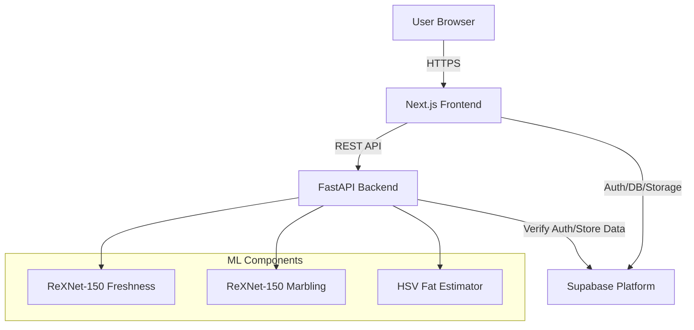
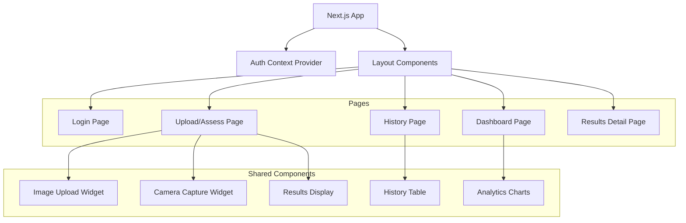
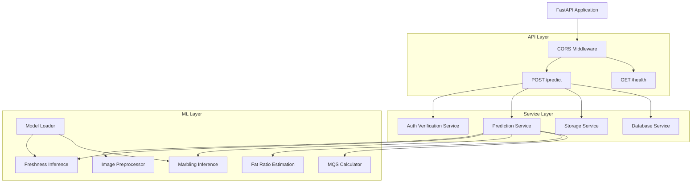
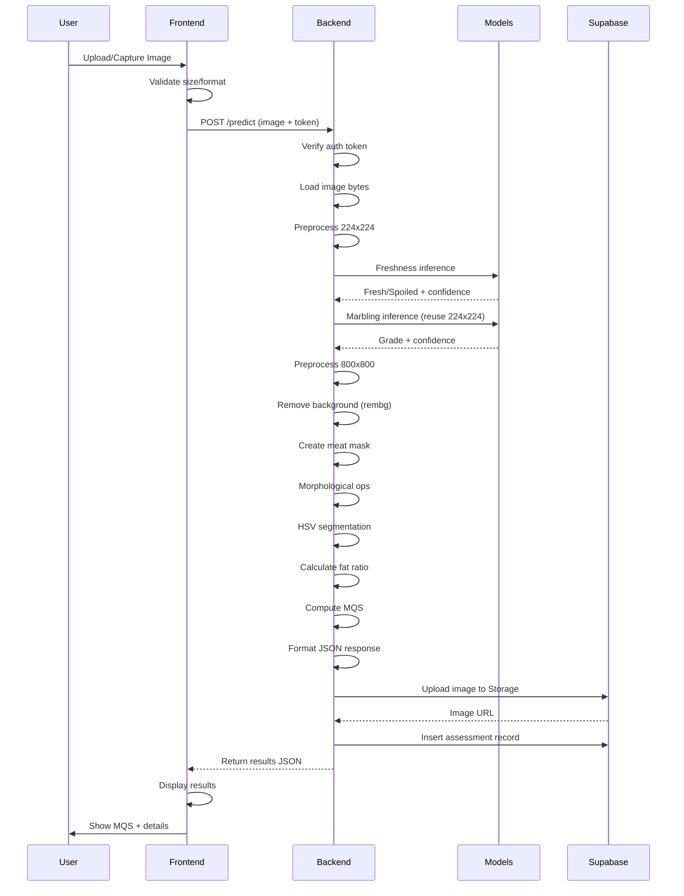

# Design Document: Beef Quality Assessment System

## Overview

The Beef Quality Assessment System is a production web application that provides automated beef quality evaluation through image analysis using trained machine learning models. The system combines computer vision and deep learning techniques to assess three key quality metrics: freshness, marbling grade, and fat ratio, which are aggregated into a comprehensive Meat Quality Score (MQS).

### System Architecture

The system follows a modern three-tier architecture:

1. **Frontend Layer** (Next.js/React/TypeScript)
   - User interface for image upload/capture
   - Results visualization and history
   - Authentication UI
   - Dashboard analytics

2. **Backend Layer** (FastAPI/Python)
   - ML model serving and inference
   - Image preprocessing pipeline
   - Computer vision processing (HSV-based fat estimation)
   - API endpoints for predictions

3. **Data Layer** (Supabase)
   - PostgreSQL database for assessment records
   - Supabase Auth for user management
   - Supabase Storage for image persistence
   - Row Level Security for data isolation

### Technology Stack

**Frontend:**
- Next.js 14+ (App Router)
- TypeScript
- React 18+
- Tailwind CSS
- shadcn/ui component library
- Supabase JS client

**Backend:**
- FastAPI (Python 3.9+)
- PyTorch 2.0+
- timm (PyTorch Image Models)
- rembg (background removal)
- OpenCV (cv2) for image processing
- NumPy for numerical operations
- Pillow (PIL) for image handling
- python-multipart for file uploads
- Supabase Python client

**Infrastructure:**
- Supabase Cloud (Auth, Database, Storage)
- CORS-enabled API communication

### Design Principles

1. **Separation of Concerns**: Clear boundaries between frontend, backend, and data layers
2. **Model Reuse**: Leverage pre-trained models without modification
3. **Security First**: Authentication, authorization, and data isolation
4. **Performance**: Efficient model loading, GPU utilization, batch processing
5. **Maintainability**: Clean code structure, environment-based configuration
6. **User Experience**: Clear feedback, error handling, responsive design

## Architecture

### System Context Diagram



### Component Architecture

#### Frontend Components



**Key Frontend Modules:**

1. **Authentication Module**
   - Supabase Auth integration
   - Session management
   - Protected route guards
   - User profile state

2. **Image Capture Module**
   - File upload with drag-and-drop
   - Camera access for live capture
   - Image preview and validation
   - Size and format validation

3. **API Client Module**
   - HTTP client with authentication
   - Multipart form-data handling
   - Error handling and retry logic
   - Response type definitions

4. **Results Visualization Module**
   - MQS display with color coding
   - Confidence indicators
   - Image comparison view
   - Metric breakdowns

5. **History Management Module**
   - Assessment list with pagination
   - Filtering and sorting
   - Detail view navigation
   - Data fetching from Supabase

#### Backend Components



**Key Backend Modules:**

1. **Model Management Module**
   - Model loading on startup
   - Device selection (CUDA/CPU)
   - State dict loading for ReXNet-150
   - Model evaluation mode
   - Singleton pattern for model instances

2. **Preprocessing Module**
   - Image resizing (224x224 for classifiers, 800x800 for fat estimation)
   - Tensor conversion
   - ImageNet normalization
   - Batch dimension handling
   - Device transfer

3. **Inference Module**
   - Freshness classification (2 classes)
   - Marbling classification (5 classes)
   - Softmax probability computation
   - Confidence extraction
   - torch.inference_mode() context

4. **Computer Vision Module**
   - Background removal (rembg)
   - Meat mask creation (alpha channel thresholding)
   - Morphological operations (closing, opening)
   - HSV color space conversion
   - Fat pixel detection
   - Ratio calculation

5. **Scoring Module**
   - Freshness score mapping (50 or 0)
   - Marbling grade mapping (10-30 points)
   - Fat ratio capping (max 20 points)
   - MQS formula application
   - Result validation

6. **Integration Module**
   - Supabase client initialization
   - Auth token verification
   - Database record insertion
   - Storage upload with UUID naming
   - User-based folder organization

### Prediction Pipeline Flow



### Deployment Architecture

**Development Environment:**
- Frontend: `localhost:3000` (Next.js dev server)
- Backend: `localhost:8000` (uvicorn with reload)
- Supabase: Cloud instance
- CORS: Allow localhost origins

**Production Environment:**
- Frontend: Vercel/Netlify deployment
- Backend: Cloud hosting (AWS/GCP/Azure) with GPU support
- Supabase: Production project
- CORS: Restricted to production frontend domain
- HTTPS enforcement

## Components and Interfaces

### Frontend Components

#### 1. Authentication Components

**`AuthProvider` (Context Provider)**
- **Responsibility**: Manage authentication state across application
- **State**:
  - `user`: Current user object or null
  - `session`: Supabase session
  - `loading`: Auth state loading flag
- **Methods**:
  - `signUp(email, password)`: Register new user
  - `signIn(email, password)`: Authenticate user
  - `signOut()`: End session
  - `getAccessToken()`: Retrieve current JWT

**`LoginPage` (Page Component)**
- **Responsibility**: User authentication UI
- **Features**:
  - Email/password form
  - Client-side validation
  - Error display
  - Redirect on success

**`ProtectedRoute` (HOC)**
- **Responsibility**: Guard authenticated routes
- **Behavior**:
  - Check session validity
  - Redirect to login if unauthenticated
  - Render children if authenticated

#### 2. Image Input Components

**`ImageUploadWidget` (Component)**
- **Props**:
  - `onImageSelected: (file: File) => void`
  - `maxSizeMB?: number` (default: 10)
- **Features**:
  - Drag-and-drop zone
  - File picker button
  - Format validation (JPEG, PNG)
  - Size validation
  - Preview display
  - Clear/reset functionality

**`CameraCaptureWidget` (Component)**
- **Props**:
  - `onImageCaptured: (blob: Blob) => void`
- **Features**:
  - Camera permission request
  - Live video stream preview
  - Capture button
  - Device selection (front/back camera)
  - Fallback to file upload if camera unavailable

#### 3. Assessment Components

**`AssessmentPage` (Page Component)**
- **State**:
  - `selectedImage: File | null`
  - `isProcessing: boolean`
  - `results: PredictionResponse | null`
  - `error: string | null`
- **Methods**:
  - `handleImageSubmit()`: Send image to backend
  - `handleReset()`: Clear results and start new assessment
- **UI Flow**:
  1. Image selection (upload or capture)
  2. Submit button with loading state
  3. Results display on success
  4. Error message on failure

**`ResultsDisplay` (Component)**
- **Props**:
  - `results: PredictionResponse`
  - `imageUrl: string`
- **Display Elements**:
  - Large MQS badge with color gradient (0-50: red, 51-75: yellow, 76-100: green)
  - Freshness status with icon and confidence bar
  - Marbling grade with icon and confidence bar
  - Fat ratio gauge with category badge
  - Original image thumbnail
  - Timestamp
  - Save to history button

#### 4. History Components

**`HistoryPage` (Page Component)**
- **State**:
  - `assessments: Assessment[]`
  - `loading: boolean`
  - `selectedId: string | null`
- **Features**:
  - Fetch from Supabase on mount
  - Sort by date descending
  - Click to view details
  - Infinite scroll or pagination

**`HistoryTable` (Component)**
- **Props**:
  - `assessments: Assessment[]`
  - `onSelect: (id: string) => void`
- **Columns**:
  - Thumbnail
  - Date/Time
  - MQS
  - Freshness
  - Marbling
  - Fat Ratio
  - Actions (view, delete)

**`AssessmentDetailPage` (Page Component)**
- **Params**: `id` (assessment UUID)
- **Data**: Fetch specific assessment from Supabase
- **Display**: Full results view with all metrics

#### 5. Dashboard Components

**`DashboardPage` (Page Component)**
- **State**:
  - `stats: AnalyticsData`
  - `loading: boolean`
- **Features**:
  - Fetch aggregate data from Supabase
  - Display summary cards
  - Render charts

**`AnalyticsCards` (Component)**
- **Display**:
  - Total assessments count
  - Average MQS
  - Fresh vs Spoiled ratio
  - Most common marbling grade

**`DistributionCharts` (Component)**
- **Charts**:
  - Pie chart: Freshness distribution
  - Bar chart: Marbling grade distribution
  - Line chart: MQS over time

### Backend Components

#### 1. Application Initialization

**`main.py` (Entry Point)**
```python
from fastapi import FastAPI
from fastapi.middleware.cors import CORSMiddleware
from contextlib import asynccontextmanager

app = FastAPI(title="Beef Quality Assessment API")

# Lifespan context for model loading
@asynccontextmanager
async def lifespan(app: FastAPI):
    # Startup: Load models
    await load_models()
    yield
    # Shutdown: Cleanup if needed
    pass

app = FastAPI(lifespan=lifespan)

# CORS configuration
app.add_middleware(
    CORSMiddleware,
    allow_origins=["http://localhost:3000", os.getenv("FRONTEND_URL")],
    allow_credentials=True,
    allow_methods=["POST", "GET"],
    allow_headers=["Content-Type", "Authorization"],
)
```

#### 2. Model Loading Module

**`models/loader.py`**
```python
import torch
import timm
from pathlib import Path

class ModelManager:
    def __init__(self):
        self.device = torch.device("cuda" if torch.cuda.is_available() else "cpu")
        self.freshness_model = None
        self.marbling_model = None
    
    def load_models(self):
        # Initialize architecture
        self.freshness_model = timm.create_model(
            "rexnet_150",
            pretrained=False,
            num_classes=2
        )
        self.marbling_model = timm.create_model(
            "rexnet_150",
            pretrained=False,
            num_classes=5
        )
        
        # Load state dicts
        freshness_path = Path(os.getenv("FRESHNESS_MODEL_PATH"))
        marbling_path = Path(os.getenv("MARBLING_MODEL_PATH"))
        
        self.freshness_model.load_state_dict(torch.load(freshness_path, map_location=self.device))
        self.marbling_model.load_state_dict(torch.load(marbling_path, map_location=self.device))
        
        # Set to eval mode and move to device
        self.freshness_model.eval()
        self.marbling_model.eval()
        self.freshness_model.to(self.device)
        self.marbling_model.to(self.device)
    
    def get_freshness_model(self):
        return self.freshness_model
    
    def get_marbling_model(self):
        return self.marbling_model
    
    def get_device(self):
        return self.device

# Global singleton
model_manager = ModelManager()
```

#### 3. Preprocessing Module

**`preprocessing/image_processor.py`**
```python
import torch
from torchvision import transforms
from PIL import Image

class ImagePreprocessor:
    def __init__(self):
        self.transform_224 = transforms.Compose([
            transforms.Resize((224, 224)),
            transforms.ToTensor(),
            transforms.Normalize(
                mean=[0.485, 0.456, 0.406],
                std=[0.229, 0.224, 0.225]
            )
        ])
    
    def preprocess_for_classifier(self, image: Image.Image, device: torch.device):
        tensor = self.transform_224(image)
        tensor = tensor.unsqueeze(0)  # Add batch dimension
        tensor = tensor.to(device)
        return tensor
    
    def resize_for_fat_estimation(self, image: Image.Image):
        return image.resize((800, 800))

preprocessor = ImagePreprocessor()
```

#### 4. Inference Module

**`inference/predictor.py`**
```python
import torch
import torch.nn.functional as F

class FreshnessPredictor:
    LABELS = ["Fresh", "Spoiled"]
    SCORES = [50, 0]
    
    def predict(self, model, tensor, device):
        with torch.inference_mode():
            logits = model(tensor)
            probs = F.softmax(logits, dim=1)
            confidence, pred_class = torch.max(probs, dim=1)
            
            class_idx = pred_class.item()
            conf_percent = confidence.item() * 100
            
            return {
                "label": self.LABELS[class_idx],
                "confidence": round(conf_percent, 2),
                "score": self.SCORES[class_idx]
            }

class MarblingPredictor:
    LABELS = ["small", "slight", "modest", "moderate", "slightly_abundant"]
    SCORES = [10, 15, 20, 25, 30]
    
    def predict(self, model, tensor, device):
        with torch.inference_mode():
            logits = model(tensor)
            probs = F.softmax(logits, dim=1)
            confidence, pred_class = torch.max(probs, dim=1)
            
            class_idx = pred_class.item()
            conf_percent = confidence.item() * 100
            
            return {
                "label": self.LABELS[class_idx],
                "confidence": round(conf_percent, 2),
                "score": self.SCORES[class_idx]
            }

freshness_predictor = FreshnessPredictor()
marbling_predictor = MarblingPredictor()
```

#### 5. Computer Vision Module

**`cv/fat_estimator.py`**
```python
import cv2
import numpy as np
from rembg import remove
from PIL import Image

class FatRatioEstimator:
    def estimate(self, image: Image.Image):
        # Resize to 800x800
        img_resized = image.resize((800, 800))
        
        # Remove background
        img_no_bg = remove(img_resized)
        img_array = np.array(img_no_bg)
        
        # Create meat mask from alpha channel
        alpha = img_array[:, :, 3]
        meat_mask = (alpha > 127).astype(np.uint8) * 255
        
        # Morphological operations
        kernel = cv2.getStructuringElement(cv2.MORPH_ELLIPSE, (7, 7))
        meat_mask = cv2.morphologyEx(meat_mask, cv2.MORPH_CLOSE, kernel)
        meat_mask = cv2.morphologyEx(meat_mask, cv2.MORPH_OPEN, kernel)
        
        # Extract meat region
        meat_region = cv2.bitwise_and(img_array[:, :, :3], img_array[:, :, :3], mask=meat_mask)
        
        # Convert to HSV
        meat_hsv = cv2.cvtColor(meat_region, cv2.COLOR_RGB2HSV)
        
        # Fat detection in HSV space
        lower_fat = np.array([0, 0, 120])
        upper_fat = np.array([180, 120, 255])
        fat_mask = cv2.inRange(meat_hsv, lower_fat, upper_fat)
        
        # Calculate ratio
        meat_pixels = np.count_nonzero(meat_mask)
        fat_pixels = np.count_nonzero(fat_mask)
        
        if meat_pixels == 0:
            return {"percent": 0.0, "category": "None"}
        
        fat_ratio = (fat_pixels / meat_pixels) * 100
        
        # Categorize
        if fat_ratio < 1.0:
            category = "None"
        elif fat_ratio < 15.0:
            category = "Small"
        else:
            category = "Large"
        
        return {
            "percent": round(fat_ratio, 2),
            "category": category,
            "score": min(fat_ratio, 20.0)  # Cap at 20 for MQS
        }

fat_estimator = FatRatioEstimator()
```

#### 6. Scoring Module

**`scoring/mqs_calculator.py`**
```python
class MQSCalculator:
    def calculate(self, freshness_score, marbling_score, fat_score):
        mqs = freshness_score + marbling_score + fat_score
        
        # Validation: spoiled beef cannot exceed 50 points
        if freshness_score == 0 and mqs > 50:
            mqs = 50
        
        # Ensure valid range
        mqs = max(0, min(100, mqs))
        
        return round(mqs, 1)

mqs_calculator = MQSCalculator()
```

#### 7. API Endpoint

**`routes/predict.py`**
```python
from fastapi import APIRouter, File, UploadFile, Header, HTTPException
from PIL import Image
import io

router = APIRouter()

@router.post("/predict")
async def predict_beef_quality(
    file: UploadFile = File(...),
    authorization: str = Header(None)
):
    try:
        # Verify auth token
        if not authorization or not authorization.startswith("Bearer "):
            raise HTTPException(status_code=401, detail="Missing or invalid token")
        
        token = authorization.split(" ")[1]
        user_id = await verify_supabase_token(token)
        
        # Load image
        image_bytes = await file.read()
        image = Image.open(io.BytesIO(image_bytes)).convert("RGB")
        
        # Preprocess for classifiers (224x224)
        tensor_224 = preprocessor.preprocess_for_classifier(image, model_manager.get_device())
        
        # Freshness prediction
        freshness_result = freshness_predictor.predict(
            model_manager.get_freshness_model(),
            tensor_224,
            model_manager.get_device()
        )
        
        # Marbling prediction (reuse same tensor)
        marbling_result = marbling_predictor.predict(
            model_manager.get_marbling_model(),
            tensor_224,
            model_manager.get_device()
        )
        
        # Fat ratio estimation (separate 800x800 processing)
        fat_result = fat_estimator.estimate(image)
        
        # Calculate MQS
        mqs = mqs_calculator.calculate(
            freshness_result["score"],
            marbling_result["score"],
            fat_result["score"]
        )
        
        # Upload image to Supabase Storage
        image_url = await upload_image_to_storage(user_id, image_bytes)
        
        # Store assessment in database
        assessment_id = await store_assessment(
            user_id=user_id,
            image_url=image_url,
            freshness=freshness_result["label"],
            freshness_confidence=freshness_result["confidence"],
            marbling=marbling_result["label"],
            marbling_confidence=marbling_result["confidence"],
            fat_ratio=fat_result["percent"],
            fat_category=fat_result["category"],
            mqs=mqs
        )
        
        # Return results
        return {
            "freshness": freshness_result["label"],
            "freshness_confidence": freshness_result["confidence"],
            "marbling": marbling_result["label"],
            "marbling_confidence": marbling_result["confidence"],
            "fat_ratio_percent": fat_result["percent"],
            "fat_ratio_category": fat_result["category"],
            "meat_quality_score": mqs,
            "assessment_id": assessment_id,
            "image_url": image_url
        }
    
    except Exception as e:
        logger.error(f"Prediction error: {str(e)}")
        raise HTTPException(status_code=500, detail="Prediction failed")

@router.get("/health")
async def health_check():
    return {"status": "healthy", "models_loaded": True}
```

#### 8. Supabase Integration

**`services/supabase_service.py`**
```python
from supabase import create_client, Client
import os
import uuid

class SupabaseService:
    def __init__(self):
        url = os.getenv("SUPABASE_URL")
        key = os.getenv("SUPABASE_SERVICE_KEY")
        self.client: Client = create_client(url, key)
    
    async def verify_token(self, token: str):
        user = self.client.auth.get_user(token)
        return user.id
    
    async def upload_image(self, user_id: str, image_bytes: bytes):
        filename = f"{user_id}/{uuid.uuid4()}.jpg"
        result = self.client.storage.from_("beef-images").upload(filename, image_bytes)
        public_url = self.client.storage.from_("beef-images").get_public_url(filename)
        return public_url
    
    async def store_assessment(self, user_id, image_url, freshness, freshness_confidence, 
                               marbling, marbling_confidence, fat_ratio, fat_category, mqs):
        data = {
            "user_id": user_id,
            "image_url": image_url,
            "freshness": freshness,
            "freshness_confidence": freshness_confidence,
            "marbling": marbling,
            "marbling_confidence": marbling_confidence,
            "fat_ratio": fat_ratio,
            "fat_category": fat_category,
            "meat_quality_score": mqs,
            "created_at": "now()"
        }
        result = self.client.table("assessments").insert(data).execute()
        return result.data[0]["id"]

supabase_service = SupabaseService()
```

### API Contracts

#### POST /predict

**Request:**
```
POST /predict
Content-Type: multipart/form-data
Authorization: Bearer <supabase_jwt_token>

Form Data:
  file: <image_file> (JPEG or PNG, max 10MB)
```

**Response (200 OK):**
```json
{
  "freshness": "Fresh",
  "freshness_confidence": 95.23,
  "marbling": "moderate",
  "marbling_confidence": 87.45,
  "fat_ratio_percent": 12.34,
  "fat_ratio_category": "Small",
  "meat_quality_score": 87.3,
  "assessment_id": "uuid-string",
  "image_url": "https://..."
}
```

**Response (400 Bad Request):**
```json
{
  "detail": "Invalid image format"
}
```

**Response (401 Unauthorized):**
```json
{
  "detail": "Missing or invalid token"
}
```

**Response (500 Internal Server Error):**
```json
{
  "detail": "Prediction failed"
}
```

#### GET /health

**Request:**
```
GET /health
```

**Response (200 OK):**
```json
{
  "status": "healthy",
  "models_loaded": true
}
```

## Data Models

### Frontend TypeScript Types

```typescript
// User authentication
interface User {
  id: string;
  email: string;
  created_at: string;
}

interface Session {
  access_token: string;
  refresh_token: string;
  user: User;
}

// Prediction request and response
interface PredictionResponse {
  freshness: "Fresh" | "Spoiled";
  freshness_confidence: number;
  marbling: "small" | "slight" | "modest" | "moderate" | "slightly_abundant";
  marbling_confidence: number;
  fat_ratio_percent: number;
  fat_ratio_category: "None" | "Small" | "Large";
  meat_quality_score: number;
  assessment_id: string;
  image_url: string;
}

// Assessment record
interface Assessment {
  id: string;
  user_id: string;
  image_url: string;
  freshness: string;
  freshness_confidence: number;
  marbling: string;
  marbling_confidence: number;
  fat_ratio: number;
  fat_category: string;
  meat_quality_score: number;
  created_at: string;
}

// Analytics data
interface AnalyticsData {
  total_assessments: number;
  average_mqs: number;
  freshness_distribution: {
    Fresh: number;
    Spoiled: number;
  };
  marbling_distribution: {
    small: number;
    slight: number;
    modest: number;
    moderate: number;
    slightly_abundant: number;
  };
}
```

### Database Schema (PostgreSQL)

```sql
-- Users table (managed by Supabase Auth)
-- auth.users table is built-in

-- Assessments table
CREATE TABLE assessments (
  id UUID PRIMARY KEY DEFAULT uuid_generate_v4(),
  user_id UUID NOT NULL REFERENCES auth.users(id) ON DELETE CASCADE,
  image_url TEXT NOT NULL,
  freshness TEXT NOT NULL CHECK (freshness IN ('Fresh', 'Spoiled')),
  freshness_confidence NUMERIC(5, 2) NOT NULL CHECK (freshness_confidence >= 0 AND freshness_confidence <= 100),
  marbling TEXT NOT NULL CHECK (marbling IN ('small', 'slight', 'modest', 'moderate', 'slightly_abundant')),
  marbling_confidence NUMERIC(5, 2) NOT NULL CHECK (marbling_confidence >= 0 AND marbling_confidence <= 100),
  fat_ratio NUMERIC(5, 2) NOT NULL CHECK (fat_ratio >= 0 AND fat_ratio <= 100),
  fat_category TEXT NOT NULL CHECK (fat_category IN ('None', 'Small', 'Large')),
  meat_quality_score NUMERIC(4, 1) NOT NULL CHECK (meat_quality_score >= 0 AND meat_quality_score <= 100),
  created_at TIMESTAMP WITH TIME ZONE DEFAULT NOW(),
  
  -- Indexes for common queries
  INDEX idx_user_created (user_id, created_at DESC),
  INDEX idx_mqs (meat_quality_score),
  INDEX idx_freshness (freshness)
);

-- Row Level Security policies
ALTER TABLE assessments ENABLE ROW LEVEL SECURITY;

-- Users can only read their own assessments
CREATE POLICY "Users can view own assessments"
  ON assessments FOR SELECT
  USING (auth.uid() = user_id);

-- Users can only insert their own assessments
CREATE POLICY "Users can insert own assessments"
  ON assessments FOR INSERT
  WITH CHECK (auth.uid() = user_id);

-- Users can only delete their own assessments
CREATE POLICY "Users can delete own assessments"
  ON assessments FOR DELETE
  USING (auth.uid() = user_id);
```

### Storage Bucket Structure

```
beef-images/
├── {user_id_1}/
│   ├── {uuid_1}.jpg
│   ├── {uuid_2}.jpg
│   └── ...
├── {user_id_2}/
│   ├── {uuid_3}.jpg
│   └── ...
└── ...
```

**Bucket Policies:**
```sql
-- Users can only upload to their own folder
CREATE POLICY "Users can upload to own folder"
  ON storage.objects FOR INSERT
  WITH CHECK (
    bucket_id = 'beef-images' AND
    (storage.foldername(name))[1] = auth.uid()::text
  );

-- Users can only read their own images
CREATE POLICY "Users can view own images"
  ON storage.objects FOR SELECT
  USING (
    bucket_id = 'beef-images' AND
    (storage.foldername(name))[1] = auth.uid()::text
  );

-- Users can delete their own images
CREATE POLICY "Users can delete own images"
  ON storage.objects FOR DELETE
  USING (
    bucket_id = 'beef-images' AND
    (storage.foldername(name))[1] = auth.uid()::text
  );
```

### Backend Python Models

```python
from pydantic import BaseModel, Field
from typing import Literal
from datetime import datetime

# Request models
class PredictionRequest(BaseModel):
    # File is handled by FastAPI UploadFile, not Pydantic
    pass

# Response models
class PredictionResponse(BaseModel):
    freshness: Literal["Fresh", "Spoiled"]
    freshness_confidence: float = Field(..., ge=0, le=100)
    marbling: Literal["small", "slight", "modest", "moderate", "slightly_abundant"]
    marbling_confidence: float = Field(..., ge=0, le=100)
    fat_ratio_percent: float = Field(..., ge=0, le=100)
    fat_ratio_category: Literal["None", "Small", "Large"]
    meat_quality_score: float = Field(..., ge=0, le=100)
    assessment_id: str
    image_url: str

class ErrorResponse(BaseModel):
    detail: str

# Database models
class AssessmentRecord(BaseModel):
    id: str
    user_id: str
    image_url: str
    freshness: str
    freshness_confidence: float
    marbling: str
    marbling_confidence: float
    fat_ratio: float
    fat_category: str
    meat_quality_score: float
    created_at: datetime
```


## Correctness Properties

*A property is a characteristic or behavior that should hold true across all valid executions of a system—essentially, a formal statement about what the system should do. Properties serve as the bridge between human-readable specifications and machine-verifiable correctness guarantees.*

This section defines correctness properties for the computational core of the Beef Quality Assessment System. These properties focus on pure functions and data transformations that we control, excluding ML model predictions (which are black-box trained models), external library behaviors, and infrastructure integrations.

### Property 1: Freshness Classification Mapping

*For any* freshness class prediction (0 or 1), the system SHALL map class 0 to label "Fresh" with score 50 points, and class 1 to label "Spoiled" with score 0 points.

**Validates: Requirements 5.4, 5.5, 5.6**

### Property 2: Marbling Classification Mapping

*For any* marbling class prediction (0, 1, 2, 3, 4), the system SHALL map classes to correct labels and scores: 0→("small", 10), 1→("slight", 15), 2→("modest", 20), 3→("moderate", 25), 4→("slightly_abundant", 30).

**Validates: Requirements 6.4, 6.5**

### Property 3: Confidence Percentage Conversion

*For any* confidence value in the range [0.0, 1.0], when converted to percentage, the result SHALL be in the range [0.0, 100.0] and SHALL equal the input multiplied by 100.

**Validates: Requirements 5.7, 6.6**

### Property 4: Maximum Probability Extraction

*For any* probability tensor output from a classification model, extracting the maximum probability SHALL return the highest value and its corresponding index, and the maximum value SHALL be greater than or equal to 1/n where n is the number of classes.

**Validates: Requirements 5.3, 6.3**

### Property 5: Fat Ratio Calculation

*For any* non-zero meat pixel count and any fat pixel count, the fat ratio SHALL equal (fat_pixels / meat_pixels * 100) rounded to 2 decimal places, and SHALL be in the range [0.0, 100.0].

**Validates: Requirements 7.9, 7.13**

### Property 6: Fat Ratio Categorization

*For any* fat ratio percentage value, the system SHALL categorize as follows: ratio < 1.0 → "None", 1.0 ≤ ratio < 15.0 → "Small", ratio ≥ 15.0 → "Large", and the categorization boundaries SHALL be consistent and non-overlapping.

**Validates: Requirements 7.10, 7.11, 7.12**

### Property 7: MQS Calculation and Range Validation

*For any* valid freshness score (0 or 50), marbling score (10, 15, 20, 25, or 30), and fat ratio (0 to 100), the MQS SHALL equal freshness_score + marbling_score + min(fat_ratio, 20) rounded to 1 decimal place, and the result SHALL always be in the range [0.0, 100.0].

**Validates: Requirements 8.1, 8.2, 8.4, 8.6, 17.7**

### Property 8: MQS Spoiled Beef Constraint

*For any* assessment where freshness is "Spoiled" (freshness_score = 0), the computed MQS SHALL never exceed 50.0 points, regardless of marbling and fat ratio values.

**Validates: Requirements 8.3**

### Property 9: Prediction Response Schema Completeness

*For any* successful prediction result, the JSON response SHALL contain exactly these fields with correct types: freshness (string), freshness_confidence (float 0-100), marbling (string), marbling_confidence (float 0-100), fat_ratio_percent (float 0-100), fat_ratio_category (string), meat_quality_score (float 0-100), assessment_id (string), image_url (string).

**Validates: Requirements 9.7, 17.8**

## Error Handling

### Frontend Error Handling

**Network Errors:**
- Implement retry logic with exponential backoff (3 attempts)
- Display user-friendly error messages
- Preserve user's image and allow re-submission
- Graceful degradation for offline scenarios

**Validation Errors:**
- Client-side validation before API call
- File size validation (max 10MB)
- File type validation (JPEG, PNG only)
- Clear error messages with suggested corrections

**API Errors:**
- Handle 400 Bad Request: Display specific validation error
- Handle 401 Unauthorized: Redirect to login with return URL
- Handle 500 Internal Server Error: Display generic error with support contact
- Handle timeout: Display timeout message with retry option

**Component Error Boundaries:**
- React Error Boundaries around major components
- Fallback UI for crashed components
- Error reporting to logging service (optional)

### Backend Error Handling

**Model Loading Errors:**
- Validate model file existence on startup
- Check model file integrity
- Log detailed error information
- Exit with non-zero code if models fail to load
- Implement health check endpoint returning model status

**Image Processing Errors:**
```python
class ImageProcessingError(Exception):
    """Raised when image processing fails"""
    pass

# In prediction pipeline:
try:
    image = Image.open(io.BytesIO(image_bytes)).convert("RGB")
except Exception as e:
    logger.error(f"Failed to load image: {str(e)}")
    raise HTTPException(status_code=400, detail="Invalid image file")

try:
    # Fat estimation with rembg
    img_no_bg = remove(img_resized)
except Exception as e:
    logger.error(f"Background removal failed: {str(e)}")
    raise HTTPException(status_code=500, detail="Image processing failed")
```

**Authentication Errors:**
- Validate token presence
- Verify token with Supabase (handle network errors)
- Return 401 for invalid/expired tokens
- Log authentication failures

**Database Errors:**
- Handle connection failures
- Handle constraint violations
- Retry transient errors (connection timeout)
- Log all database errors with context
- Return 500 for persistent database issues

**Storage Errors:**
- Handle upload failures
- Validate storage space availability
- Retry transient errors
- Log storage errors
- Clean up partial uploads on failure

**Pipeline Error Handling:**
```python
async def predict_beef_quality(file, authorization):
    try:
        # Validate and authenticate
        user_id = await verify_token(authorization)
        
        # Load image
        image = await load_image(file)
        
        # Prediction pipeline with staged error handling
        freshness = await predict_freshness(image)
        marbling = await predict_marbling(image)
        fat_ratio = await estimate_fat_ratio(image)
        mqs = calculate_mqs(freshness, marbling, fat_ratio)
        
        # Store results (transactional)
        image_url = await upload_image(user_id, image)
        assessment_id = await store_assessment(user_id, results, image_url)
        
        return results
        
    except HTTPException:
        raise  # Re-raise HTTP exceptions
    except Exception as e:
        logger.exception(f"Prediction pipeline failed: {str(e)}")
        raise HTTPException(status_code=500, detail="Prediction failed")
```

**Logging Strategy:**
- Structured logging with JSON format
- Include timestamp, request_id, user_id, error type
- Log levels: DEBUG (development), INFO (production), ERROR (always)
- Separate log files for errors
- PII redaction in logs

### Error Monitoring

**Backend Monitoring:**
- Health check endpoint: `GET /health`
- Metrics: request count, error rate, latency, GPU memory
- Alerting for high error rates
- Log aggregation and search

**Frontend Monitoring:**
- Client-side error tracking (optional: Sentry)
- User session replay for debugging (optional)
- Performance monitoring (Core Web Vitals)

## Testing Strategy

The Beef Quality Assessment System requires a comprehensive testing strategy that balances automated verification with practical testing approaches appropriate for ML-integrated applications.

### Testing Approach Overview

**Unit Tests** (pytest for backend, Jest/React Testing Library for frontend):
- Pure function logic (score calculations, mappings, validations)
- Component rendering and user interactions
- Error handling paths
- Edge cases and boundary conditions

**Property-Based Tests** (Hypothesis for Python):
- Mathematical computations (MQS formula, ratio calculations)
- Data transformations (score mappings, categorizations)
- Input validation functions
- JSON schema validation
- Run with minimum 100 iterations per property

**Integration Tests**:
- ML model loading and inference pipelines
- Image preprocessing with library functions
- Supabase authentication, database, and storage
- API endpoints with mocked models
- End-to-end prediction pipeline

**Visual/Manual Tests**:
- UI/UX verification
- Color coding and visualizations
- Responsive design across devices
- Camera capture functionality

### Backend Testing

#### 1. Property-Based Tests (High Priority)

**Test Framework:** Hypothesis (Python property-based testing library)

**Property Tests to Implement:**

```python
# test_properties.py
import pytest
from hypothesis import given, strategies as st

# Property 1: Freshness Classification Mapping
# Feature: beef-quality-assessment, Property 1: Freshness classification mapping
@given(class_idx=st.integers(min_value=0, max_value=1))
def test_freshness_mapping_property(class_idx):
    result = map_freshness_class(class_idx)
    
    if class_idx == 0:
        assert result["label"] == "Fresh"
        assert result["score"] == 50
    elif class_idx == 1:
        assert result["label"] == "Spoiled"
        assert result["score"] == 0

# Property 2: Marbling Classification Mapping
# Feature: beef-quality-assessment, Property 2: Marbling classification mapping
@given(class_idx=st.integers(min_value=0, max_value=4))
def test_marbling_mapping_property(class_idx):
    expected = {
        0: ("small", 10),
        1: ("slight", 15),
        2: ("modest", 20),
        3: ("moderate", 25),
        4: ("slightly_abundant", 30)
    }
    
    result = map_marbling_class(class_idx)
    assert result["label"] == expected[class_idx][0]
    assert result["score"] == expected[class_idx][1]

# Property 3: Confidence Percentage Conversion
# Feature: beef-quality-assessment, Property 3: Confidence percentage conversion
@given(confidence=st.floats(min_value=0.0, max_value=1.0, allow_nan=False))
def test_confidence_conversion_property(confidence):
    percent = convert_to_percentage(confidence)
    
    assert 0.0 <= percent <= 100.0
    assert abs(percent - (confidence * 100)) < 0.01  # Account for floating point

# Property 5: Fat Ratio Calculation
# Feature: beef-quality-assessment, Property 5: Fat ratio calculation
@given(
    fat_pixels=st.integers(min_value=0, max_value=640000),
    meat_pixels=st.integers(min_value=1, max_value=640000)
)
def test_fat_ratio_calculation_property(fat_pixels, meat_pixels):
    ratio = calculate_fat_ratio(fat_pixels, meat_pixels)
    
    expected = (fat_pixels / meat_pixels) * 100
    assert 0.0 <= ratio <= 100.0
    assert abs(ratio - round(expected, 2)) < 0.01

# Property 6: Fat Ratio Categorization
# Feature: beef-quality-assessment, Property 6: Fat ratio categorization
@given(fat_ratio=st.floats(min_value=0.0, max_value=100.0, allow_nan=False))
def test_fat_categorization_property(fat_ratio):
    category = categorize_fat_ratio(fat_ratio)
    
    if fat_ratio < 1.0:
        assert category == "None"
    elif 1.0 <= fat_ratio < 15.0:
        assert category == "Small"
    else:
        assert category == "Large"

# Property 7: MQS Calculation and Range Validation
# Feature: beef-quality-assessment, Property 7: MQS calculation and range validation
@given(
    freshness_score=st.sampled_from([0, 50]),
    marbling_score=st.sampled_from([10, 15, 20, 25, 30]),
    fat_ratio=st.floats(min_value=0.0, max_value=100.0, allow_nan=False)
)
def test_mqs_calculation_property(freshness_score, marbling_score, fat_ratio):
    mqs = calculate_mqs(freshness_score, marbling_score, fat_ratio)
    
    expected = freshness_score + marbling_score + min(fat_ratio, 20)
    assert 0.0 <= mqs <= 100.0
    assert abs(mqs - round(expected, 1)) < 0.1

# Property 8: MQS Spoiled Beef Constraint
# Feature: beef-quality-assessment, Property 8: MQS spoiled beef constraint
@given(
    marbling_score=st.sampled_from([10, 15, 20, 25, 30]),
    fat_ratio=st.floats(min_value=0.0, max_value=100.0, allow_nan=False)
)
def test_mqs_spoiled_constraint_property(marbling_score, fat_ratio):
    mqs = calculate_mqs(0, marbling_score, fat_ratio)  # freshness_score = 0
    
    assert mqs <= 50.0

# Property 9: Prediction Response Schema Completeness
# Feature: beef-quality-assessment, Property 9: Prediction response schema completeness
@given(
    freshness_score=st.sampled_from([0, 50]),
    marbling_score=st.sampled_from([10, 15, 20, 25, 30]),
    fat_ratio=st.floats(min_value=0.0, max_value=100.0, allow_nan=False)
)
def test_response_schema_property(freshness_score, marbling_score, fat_ratio):
    # Mock prediction results
    freshness_result = map_freshness_class(0 if freshness_score == 50 else 1)
    marbling_result = map_marbling_class(marbling_score // 5 - 2)
    fat_result = {"percent": fat_ratio, "category": categorize_fat_ratio(fat_ratio)}
    mqs = calculate_mqs(freshness_score, marbling_score, fat_ratio)
    
    response = format_prediction_response(
        freshness_result, marbling_result, fat_result, mqs,
        "test-id", "test-url"
    )
    
    # Verify all required fields exist with correct types
    assert isinstance(response["freshness"], str)
    assert isinstance(response["freshness_confidence"], float)
    assert 0.0 <= response["freshness_confidence"] <= 100.0
    assert isinstance(response["marbling"], str)
    assert isinstance(response["marbling_confidence"], float)
    assert 0.0 <= response["marbling_confidence"] <= 100.0
    assert isinstance(response["fat_ratio_percent"], float)
    assert 0.0 <= response["fat_ratio_percent"] <= 100.0
    assert isinstance(response["fat_ratio_category"], str)
    assert response["fat_ratio_category"] in ["None", "Small", "Large"]
    assert isinstance(response["meat_quality_score"], float)
    assert 0.0 <= response["meat_quality_score"] <= 100.0
    assert isinstance(response["assessment_id"], str)
    assert isinstance(response["image_url"], str)
```

**Property Test Configuration:**
- Minimum 100 iterations per test (configured in Hypothesis settings)
- Use seed for reproducibility in CI
- Include edge cases in strategies (0, 1, boundaries)
- Run in CI pipeline on every commit

#### 2. Unit Tests

**Model Loading Tests:**
```python
def test_model_loading():
    """Test that models load correctly on startup"""
    model_manager.load_models()
    assert model_manager.freshness_model is not None
    assert model_manager.marbling_model is not None
    assert not model_manager.freshness_model.training
    assert not model_manager.marbling_model.training

def test_device_selection():
    """Test correct device selection"""
    device = model_manager.get_device()
    if torch.cuda.is_available():
        assert device.type == "cuda"
    else:
        assert device.type == "cpu"

def test_model_loading_failure():
    """Test error handling when model files are missing"""
    with pytest.raises(SystemExit):
        load_models_from_path("/invalid/path")
```

**Preprocessing Tests:**
```python
def test_image_resize_224():
    """Test image resizing for classifiers"""
    image = Image.new("RGB", (1000, 800))
    tensor = preprocessor.preprocess_for_classifier(image, torch.device("cpu"))
    assert tensor.shape == (1, 3, 224, 224)

def test_batch_dimension():
    """Test batch dimension is added"""
    image = Image.new("RGB", (224, 224))
    tensor = preprocessor.preprocess_for_classifier(image, torch.device("cpu"))
    assert tensor.dim() == 4
    assert tensor.shape[0] == 1
```

**Edge Case Tests:**
```python
def test_fat_ratio_zero_meat_pixels():
    """Test fat ratio calculation with zero meat pixels"""
    result = fat_estimator.estimate_with_counts(100, 0)
    assert result["percent"] == 0.0
    assert result["category"] == "None"

def test_fat_ratio_boundary_conditions():
    """Test fat ratio categorization at boundaries"""
    assert categorize_fat_ratio(0.99) == "None"
    assert categorize_fat_ratio(1.0) == "Small"
    assert categorize_fat_ratio(14.99) == "Small"
    assert categorize_fat_ratio(15.0) == "Large"

def test_mqs_maximum_values():
    """Test MQS with maximum possible inputs"""
    mqs = calculate_mqs(50, 30, 100)
    assert mqs == 100.0

def test_image_size_validation():
    """Test image size limit enforcement"""
    # 11MB image
    large_image = b"x" * (11 * 1024 * 1024)
    with pytest.raises(HTTPException) as exc:
        validate_image_size(large_image)
    assert exc.value.status_code == 400
```

#### 3. Integration Tests

**Prediction Pipeline Tests:**
```python
@pytest.mark.integration
async def test_full_prediction_pipeline():
    """Test complete prediction flow with real models"""
    # Load test image
    test_image_path = "tests/fixtures/beef_fresh.jpg"
    
    with open(test_image_path, "rb") as f:
        image_bytes = f.read()
    
    # Mock authentication
    mock_token = create_test_token()
    
    # Call prediction endpoint
    response = await client.post(
        "/predict",
        files={"file": ("test.jpg", image_bytes, "image/jpeg")},
        headers={"Authorization": f"Bearer {mock_token}"}
    )
    
    assert response.status_code == 200
    data = response.json()
    
    # Verify response structure
    assert "freshness" in data
    assert "marbling" in data
    assert "meat_quality_score" in data
    assert 0 <= data["meat_quality_score"] <= 100

@pytest.mark.integration
async def test_supabase_integration():
    """Test Supabase authentication and database operations"""
    # Test authentication
    user_id = await supabase_service.verify_token(test_token)
    assert user_id is not None
    
    # Test image upload
    image_url = await supabase_service.upload_image(user_id, test_image_bytes)
    assert "beef-images" in image_url
    
    # Test assessment storage
    assessment_id = await supabase_service.store_assessment(
        user_id=user_id,
        image_url=image_url,
        freshness="Fresh",
        freshness_confidence=95.0,
        marbling="moderate",
        marbling_confidence=87.0,
        fat_ratio=12.5,
        fat_category="Small",
        mqs=87.5
    )
    assert assessment_id is not None
```

**Error Handling Tests:**
```python
async def test_invalid_token():
    """Test authentication with invalid token"""
    response = await client.post(
        "/predict",
        files={"file": ("test.jpg", b"fake", "image/jpeg")},
        headers={"Authorization": "Bearer invalid"}
    )
    assert response.status_code == 401

async def test_invalid_image_format():
    """Test with non-image file"""
    response = await client.post(
        "/predict",
        files={"file": ("test.txt", b"not an image", "text/plain")},
        headers={"Authorization": f"Bearer {test_token}"}
    )
    assert response.status_code == 400
```

### Frontend Testing

#### Component Tests (Jest + React Testing Library)

```typescript
// ImageUploadWidget.test.tsx
describe("ImageUploadWidget", () => {
  it("accepts valid image files", () => {
    const { getByLabelText } = render(<ImageUploadWidget onImageSelected={jest.fn()} />);
    const file = new File(["image"], "test.jpg", { type: "image/jpeg" });
    
    const input = getByLabelText(/upload/i) as HTMLInputElement;
    fireEvent.change(input, { target: { files: [file] } });
    
    expect(onImageSelected).toHaveBeenCalledWith(file);
  });
  
  it("rejects files larger than 10MB", () => {
    const { getByLabelText } = render(<ImageUploadWidget onImageSelected={jest.fn()} />);
    const largeFile = new File([new ArrayBuffer(11 * 1024 * 1024)], "large.jpg", { type: "image/jpeg" });
    
    const input = getByLabelText(/upload/i) as HTMLInputElement;
    fireEvent.change(input, { target: { files: [largeFile] } });
    
    expect(screen.getByText(/exceeds 10MB/i)).toBeInTheDocument();
  });
});

// ResultsDisplay.test.tsx
describe("ResultsDisplay", () => {
  it("displays MQS with correct color coding", () => {
    const results = {
      meat_quality_score: 85.5,
      freshness: "Fresh",
      marbling: "moderate",
      // ... other fields
    };
    
    const { getByText } = render(<ResultsDisplay results={results} imageUrl="test.jpg" />);
    
    expect(getByText("85.5")).toBeInTheDocument();
    expect(getByText("85.5")).toHaveClass("text-green-600"); // High score color
  });
  
  it("displays all metric details", () => {
    const results = createMockResults();
    const { getByText } = render(<ResultsDisplay results={results} imageUrl="test.jpg" />);
    
    expect(getByText(results.freshness)).toBeInTheDocument();
    expect(getByText(results.marbling)).toBeInTheDocument();
    expect(getByText(results.fat_ratio_category)).toBeInTheDocument();
  });
});
```

#### Integration Tests (E2E with Playwright/Cypress)

```typescript
// e2e/assessment-flow.spec.ts
describe("Assessment Flow", () => {
  beforeEach(() => {
    cy.login("test@example.com", "password");
  });
  
  it("completes full assessment workflow", () => {
    cy.visit("/assess");
    
    // Upload image
    cy.get('input[type="file"]').selectFile("cypress/fixtures/beef.jpg");
    
    // Submit for assessment
    cy.contains("Assess Quality").click();
    
    // Wait for results
    cy.contains("Meat Quality Score", { timeout: 10000 }).should("be.visible");
    
    // Verify results display
    cy.get('[data-testid="mqs-score"]').should("exist");
    cy.get('[data-testid="freshness-result"]').should("exist");
    cy.get('[data-testid="marbling-result"]').should("exist");
    
    // Check history
    cy.visit("/history");
    cy.contains("beef.jpg").should("exist");
  });
});
```

### Test Coverage Goals

- **Backend Unit Tests:** > 80% code coverage
- **Backend Property Tests:** 100% coverage of pure computation functions
- **Backend Integration Tests:** All API endpoints, all external integrations
- **Frontend Component Tests:** > 70% component coverage
- **E2E Tests:** Critical user journeys (authentication, assessment, history)

### Continuous Integration

**GitHub Actions / GitLab CI Pipeline:**

```yaml
# .github/workflows/test.yml
name: Test Suite

on: [push, pull_request]

jobs:
  backend-tests:
    runs-on: ubuntu-latest
    steps:
      - uses: actions/checkout@v3
      - uses: actions/setup-python@v4
        with:
          python-version: '3.9'
      - name: Install dependencies
        run: pip install -r requirements.txt
      - name: Run property tests
        run: pytest tests/test_properties.py -v --hypothesis-seed=12345
      - name: Run unit tests
        run: pytest tests/unit/ -v --cov=app --cov-report=xml
      - name: Run integration tests
        run: pytest tests/integration/ -v -m integration
        env:
          SUPABASE_URL: ${{ secrets.SUPABASE_URL }}
          SUPABASE_KEY: ${{ secrets.SUPABASE_KEY }}
  
  frontend-tests:
    runs-on: ubuntu-latest
    steps:
      - uses: actions/checkout@v3
      - uses: actions/setup-node@v3
        with:
          node-version: '18'
      - name: Install dependencies
        run: npm ci
      - name: Run tests
        run: npm test -- --coverage
      - name: Run E2E tests
        run: npm run test:e2e
```

### Manual Testing Checklist

**Pre-Release Testing:**
- [ ] Test with various beef images (fresh, spoiled, different marbling)
- [ ] Test with edge case images (very small, very large, unusual formats)
- [ ] Test camera capture on mobile devices (iOS Safari, Android Chrome)
- [ ] Test authentication flow (sign up, login, logout, password reset)
- [ ] Test history pagination and filtering
- [ ] Test dashboard analytics calculations
- [ ] Verify color coding accuracy across score ranges
- [ ] Test error scenarios (network failure, invalid image, timeout)
- [ ] Cross-browser testing (Chrome, Firefox, Safari, Edge)
- [ ] Responsive design testing (mobile, tablet, desktop)
- [ ] Accessibility testing (keyboard navigation, screen readers)

**Performance Testing:**
- Load test: 100 concurrent prediction requests
- Measure average response time (target: < 3 seconds)
- Monitor GPU memory usage
- Test with slow network conditions

